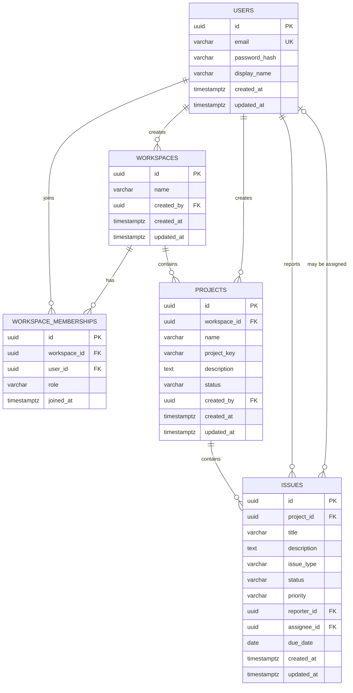

# Phase B design: database and authentication

**Status: approved design; authentication and user-management backend implemented.** The users migration, registration, JWT login, logout, current-user/profile endpoints, CSRF protection, and protected frontend routes are implemented. Workspace/project/issue tables remain future work.

## 1. Core ERD

## 2. Tables and constraints

All table and column names use lowercase `snake_case`. UUIDs are generated by the application. Times use PostgreSQL `timestamptz` and are written as UTC instants. Flyway SQL migrations are the schema source of truth; Hibernate schema creation/update stays disabled.

### `users`

Stores an account's identity and password hash. Columns: `id`, `email`, `password_hash`, `display_name`, `created_at`, and `updated_at`.

- `id` is the UUID primary key.
- `email` is required, trimmed and lowercased by the service, and unique. A database check requires the stored value to be lowercase as a backstop.
- `password_hash` is required and never returned by an API. It stores a BCrypt hash, not the supplied password.
- `display_name` is required and limited to 80 characters.
- Email lookup uses the unique index. Do not add a separate duplicate index.
- Account deletion is not part of Phase B. Foreign keys restrict hard deletion once an account is referenced; a later deactivation workflow can preserve authorship and history.

### `workspaces`

Stores `id`, `name`, `created_by`, `created_at`, and `updated_at`. `created_by` references `users.id` and records who created the workspace; ownership and authorization come from membership role, not this column alone. Names are required and limited to 120 characters.

### `workspace_memberships`

Joins users to workspaces and stores `id`, `workspace_id`, `user_id`, `role`, and `joined_at`.

- `(workspace_id, user_id)` is unique, so a user can join a workspace only once.
- `role` is limited to `OWNER`, `ADMIN`, or `MEMBER` by a check constraint.
- A partial unique index permits at most one `OWNER` per workspace. The service creates the workspace and its first owner membership in one transaction and prevents removing or demoting the last owner.
- The unique workspace/user index supports membership checks and listing workspace members. Add an index beginning with `user_id` for listing a user's workspaces.
- Deleting a workspace may cascade to memberships. User hard deletion is restricted.

### `projects`

Stores `id`, `workspace_id`, `name`, `project_key`, `description`, `status`, `created_by`, `created_at`, and `updated_at`.

- `workspace_id` references `workspaces.id`; `created_by` references `users.id`.
- `(workspace_id, project_key)` is unique. Keys are uppercase, 2–10 characters, and limited to letters and digits. Keys are scoped to a workspace and are not edited after creation in the MVP.
- `status` is `ACTIVE` or `ARCHIVED`, enforced by a check constraint.
- Deleting a project is restricted while it has issues; archive it instead.
- Add `(workspace_id, created_at)` for ordered workspace project lists. The scoped key uniqueness index already covers project lookup by workspace and key.

### `issues`

Stores `id`, `project_id`, `title`, `description`, `issue_type`, `status`, `priority`, `reporter_id`, nullable `assignee_id`, nullable `due_date`, `created_at`, and `updated_at`.

- `project_id` references `projects.id`; `reporter_id` and `assignee_id` reference `users.id`.
- `issue_type` is `TASK`, `BUG`, or `STORY`; `status` is `TODO`, `IN_PROGRESS`, `IN_REVIEW`, or `DONE`; `priority` is `LOW`, `MEDIUM`, `HIGH`, or `URGENT`. Check constraints keep stored values valid.
- The service verifies that the reporter and assignee are members of the project's workspace on every create/update. The foreign keys ensure those users exist; authorization is also checked on every read and write.
- Add `(project_id, status, created_at)` for project status views and `(assignee_id, status)` for a user's assigned work. Start with these justified indexes and add more only when query patterns require them.
- Project deletion and user deletion are restricted while referenced, preserving issue history.

## 3. Relationships and trade-offs

- Users and workspaces have a many-to-many relationship through `workspace_memberships`; the join table carries the member role and join time.
- A workspace contains projects; a project contains issues. Issue workspace is derived through its project rather than duplicated on the issue row.
- Each issue has one reporter and may have one assignee. An assignee must be a workspace member; the service enforces this cross-table rule transactionally because a simple foreign key cannot express it without duplicating workspace data.
- UUIDs avoid exposing sequential account/workspace IDs and make IDs straightforward to create in Java. They are larger than integer keys but appropriate for this portfolio application.
- Enums are stored as `varchar` with SQL check constraints rather than PostgreSQL enum types. This keeps adding a new value manageable through a normal Flyway migration.
- Foreign keys use restrictive deletion for authored/project data. Workspace membership rows may cascade when a workspace is physically deleted, but project and issue history must first be archived or handled by an explicit business workflow.
- Comments, activity history, notifications, invitations, and refresh-token/revocation storage are intentionally outside this initial schema.

## 4. Phase B auth and user API

All routes use `/api/v1`. Registration, login, logout, and CSRF bootstrap are public; `/users/me` requires authentication. Logout remains public so a browser can clear an expired or otherwise unusable access cookie, and still requires a valid CSRF token. Inputs use Bean Validation. Entities are never serialized directly.

| Method and path | Access | Request | Success | Main errors |
| --- | --- | --- | --- | --- |
| `GET /api/v1/auth/csrf` | Public | None | `204`; sets the `XSRF-TOKEN` cookie | `500` |
| `POST /api/v1/auth/register` | Public + valid CSRF token | `{ "email", "password", "displayName" }` | `201` safe user response; no password hash or access token | `400` invalid fields, `409` email already registered |
| `POST /api/v1/auth/login` | Public + valid CSRF token | `{ "email", "password" }` | `200` safe user response and `Set-Cookie` access token | `400` malformed input, `401` generic invalid credentials |
| `POST /api/v1/auth/logout` | Valid CSRF token | None | `204`; clears the access-token cookie | `403` invalid CSRF token |
| `GET /api/v1/users/me` | Authenticated | None | `200` safe current-user response | `401` unauthenticated |
| `PATCH /api/v1/users/me` | Authenticated + valid CSRF token | `{ "displayName" }` | `200` updated safe user response | `400` invalid name, `401` unauthenticated |

Registration requires a valid email, a password of at least 12 characters and no more than 72 UTF-8 bytes, and a display name of 1–80 characters. The service enforces the byte limit required by BCrypt. Email is trimmed and normalized to lowercase before duplicate checks and persistence. Login uses the same generic `401` message whether the email is unknown or the password is wrong, to avoid disclosing account existence. Updating an email is deferred until an email-verification workflow exists.

Errors use one JSON shape with `status`, `code`, `message`, `path`, and optional `fieldErrors`. Validation failures return `400`; missing/invalid credentials return `401`; authenticated users lacking permission return `403`; missing resources return `404`; uniqueness conflicts return `409`; unexpected failures return a non-sensitive `500` response.

## 5. Token and CSRF decision

Use a short-lived JWT access token in an `HttpOnly` cookie, never in local storage. The cookie is `Secure` in production, `SameSite=Lax`, scoped to `/api`, and has a 15-minute lifetime. Local development uses the Vite `/api` proxy so browser requests remain same-origin; the `Secure` flag is disabled only for local HTTP.

Cookie authentication is automatically sent by the browser, so CSRF protection stays enabled. The backend issues a separate readable CSRF token cookie from the CSRF bootstrap endpoint; the frontend sends that value in `X-XSRF-TOKEN` on every state-changing request, including registration, login, and logout. The Spring Security SPA request handler accepts the raw cookie value in the header while retaining BREACH protection for rendered token values. The CSRF token is not an authentication credential. Production should serve the frontend and API on the same site; a cross-site deployment would need `SameSite=None; Secure`, credentialed CORS restricted to the exact frontend origin, and the same CSRF header check.

There is no refresh token or server-side JWT revocation in the MVP. Logout clears the browser cookie, while a copied token remains valid only until its short expiry. Signing keys come from environment/secret configuration and are never committed.

## 6. Implementation sequence after review

1. **Complete:** approve this schema and API proposal.
2. **Complete:** add PostgreSQL, Spring Data JPA, Flyway, validation, security, and Actuator configuration; create the initial users migration.
3. **Complete:** implement account registration with normalization/validation, BCrypt hashing, duplicate-email conflict, safe response, CSRF protection, and PostgreSQL-backed tests.
4. **Complete:** implement short-lived JWT login, HttpOnly cookie authentication, logout, current-user/profile update endpoints, React registration/login forms, and protected account routes.
5. Add workspace/project/issue entities and APIs, keeping authorization checks on the backend.
