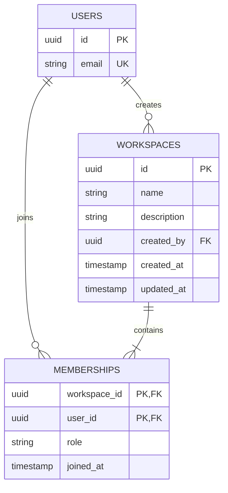

# Phase C: Workspaces and Memberships

## Data model

`workspaces` stores the workspace profile and creator. `memberships` joins users to workspaces using a composite primary key, so a user can join a workspace once. Roles are `OWNER`, `ADMIN`, and `MEMBER`; creation inserts the creator as `OWNER` in the same transaction. Membership foreign keys cascade on workspace/user deletion; a workspace creator reference restricts deletion while that workspace exists. Indexes support listing a user's workspaces and members of a workspace.

## Initial API contract

All endpoints require a valid authenticated user. State-changing requests also require the existing CSRF cookie/header pair.

| Method and path | Access | Result |
| --- | --- | --- |
| `POST /api/v1/workspaces` | Any authenticated user | Create workspace and owner membership (`201`) |
| `GET /api/v1/workspaces` | Member | List caller's workspaces, including caller role |
| `GET /api/v1/workspaces/{id}` | Member | Workspace details |
| `PATCH /api/v1/workspaces/{id}` | Owner or admin | Update name and description |
| `DELETE /api/v1/workspaces/{id}` | Owner | Delete workspace and memberships (`204`) |
| `GET /api/v1/workspaces/{id}/members` | Member | List workspace members |
| `POST /api/v1/workspaces/{id}/members` | Owner or admin | Add an existing registered user by email |
| `PATCH /api/v1/workspaces/{id}/members/{userId}` | Owner/admin; admins cannot edit other admins | Change role; owners cannot be reassigned through this endpoint |
| `DELETE /api/v1/workspaces/{id}/members/{userId}` | Owner/admin or the member themself | Remove a non-owner member |

Adding a member is a direct MVP workflow; invitations and email delivery are deferred. Admins can add members and assign either `MEMBER` or `ADMIN`; owners can manage all non-owner memberships. Non-members receive `404` for workspace-scoped operations to avoid exposing workspace existence. Authenticated users cannot grant or remove ownership. Ownership transfer is a later feature; the current owner can delete the workspace.

## Review notes

- Membership access is checked in the service for every workspace operation; frontend checks are not trusted.
- Workspace creation and owner membership insertion share one transaction.
- Database uniqueness protects against duplicate membership even under concurrent requests.
- User entities and password hashes are never serialized; responses use dedicated DTOs.
- Workspace deletion removes membership rows in the same transaction before deleting the workspace.
