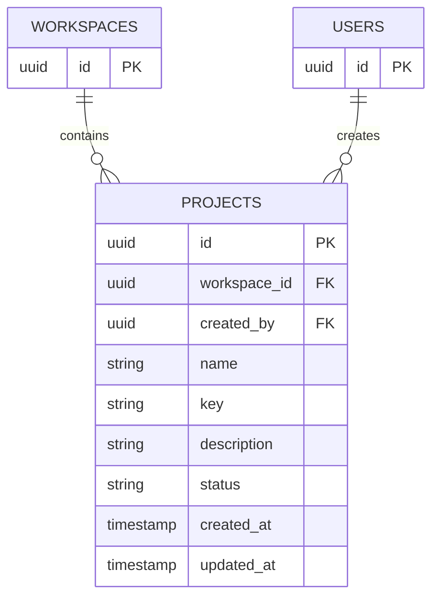

# Phase D: Projects

## Data model

`projects` belongs to one workspace and records its creator. The project key is supplied at creation, normalized to uppercase, and immutable after creation so it remains a stable identifier for later issue keys. Keys are unique within a workspace, allowing different workspaces to reuse a key. Status is `ACTIVE` or `ARCHIVED`; archiving is reversible and avoids permanently deleting project history.

| Field | Type | Rules |
| --- | --- | --- |
| `id` | UUID | Primary key |
| `workspace_id` | UUID | Required; cascades when its workspace is deleted |
| `created_by` | UUID | Required user reference; restricts deletion while project exists |
| `name` | varchar(120) | Required, non-blank |
| `key` | varchar(10) | Required; uppercase letters/digits, begins with a letter, 2–10 characters; unique within workspace |
| `description` | varchar(2000) | Optional |
| `status` | varchar(16) | `ACTIVE` or `ARCHIVED`, default `ACTIVE` |
| `created_at`, `updated_at` | timestamptz | Required timestamps |

The unique `(workspace_id, key)` constraint prevents duplicates under concurrent requests. A `(workspace_id, status, name)` index supports the workspace project list. The database also checks valid keys, status values, and non-blank names.

## API contract

Every project read checks current workspace membership. Any workspace member may create and view projects. Only workspace owners and admins may edit project details, archive, or restore a project. Non-members receive `404` for project-scoped requests so project existence is not disclosed across workspace boundaries. State-changing requests require the existing CSRF cookie/header.

| Method and path | Access | Request | Result |
| --- | --- | --- | --- |
| `POST /api/v1/workspaces/{workspaceId}/projects` | Workspace member | `{ "name", "key", "description?" }` | `201`, new active project |
| `GET /api/v1/workspaces/{workspaceId}/projects` | Workspace member | — | `200`, workspace projects including status |
| `GET /api/v1/projects/{projectId}` | Workspace member | — | `200`, project details |
| `PATCH /api/v1/projects/{projectId}` | Workspace owner/admin | `{ "name", "description?" }` | `200`, updated details; key remains immutable |
| `PATCH /api/v1/projects/{projectId}/status` | Workspace owner/admin | `{ "status": "ACTIVE" | "ARCHIVED" }` | `200`, updated status |

Validation errors return `400`, duplicate keys return `409`, missing projects/workspaces return `404`, and insufficient role returns `403`. Project deletion is intentionally not exposed; archive/restore is reversible and will preserve future issue history.

## Review notes

- Membership authorization is enforced in the service for each operation, not delegated to frontend controls.
- Project creation stores the authenticated creator and checks workspace membership before writing.
- The project key cannot be changed once created, preserving references for future issue identifiers.
- DTOs prevent entities and user-sensitive fields from appearing in API responses.
