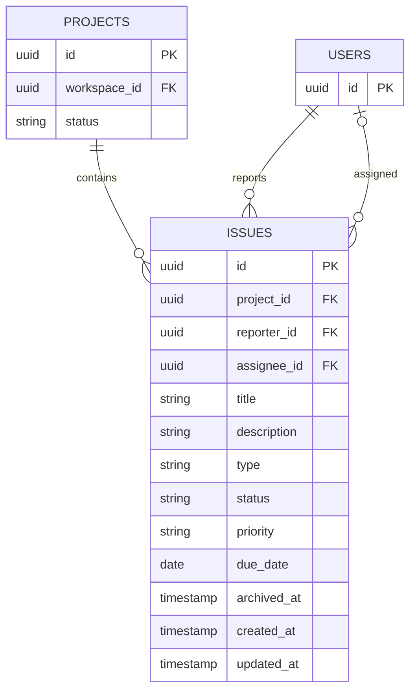

# Phase E: Issues and Task Management

## Data model

Issues are scoped to a project; project membership derives from its workspace. `reporter_id` is the authenticated user who created the issue and cannot be changed. `assignee_id` is optional and can only refer to a member of the same workspace. IDs remain UUIDs; sequential project issue numbers are deferred to avoid introducing a counter and concurrency policy before issue key requirements exist.

| Field | Type | Rules |
| --- | --- | --- |
| `id` | UUID | Primary key |
| `project_id` | UUID | Required; cascades if its project is removed |
| `reporter_id` | UUID | Required; deletion restricted to preserve issue attribution |
| `assignee_id` | UUID | Optional; becomes null if the user is deleted |
| `title` | varchar(200) | Required, non-blank |
| `description` | varchar(10000) | Optional |
| `type` | varchar(16) | `TASK`, `BUG`, or `STORY` |
| `status` | varchar(20) | `TODO`, `IN_PROGRESS`, `IN_REVIEW`, or `DONE` |
| `priority` | varchar(16) | `LOW`, `MEDIUM`, `HIGH`, or `URGENT` |
| `due_date` | date | Optional calendar date |
| `archived_at` | timestamptz | Null while active; set to archive and cleared to restore |
| `created_at`, `updated_at` | timestamptz | Required timestamps |

Database checks enforce non-blank titles and supported enum strings. Indexes cover `(project_id, status, created_at)`, `(project_id, assignee_id)`, and `(project_id, due_date)` for common project filters. Issues are archived instead of permanently deleted so collaboration/audit history can be added later. Project deletion cascades issues; reporter deletion is restricted and deleting an assignee clears the assignment.

## API contract

All operations require authentication, workspace membership for the issue's project, and CSRF protection for state changes. Workspace members can create/read/update issues. Only workspace owners/admins can archive or restore. Non-members receive `404` for project/issue resources. Mutations that create or edit issues require the project to be `ACTIVE`; archived projects remain readable.

| Method and path | Access | Request / query | Result |
| --- | --- | --- | --- |
| `POST /api/v1/projects/{projectId}/issues` | Workspace member | title, description?, type, status?, priority?, assigneeId?, dueDate? | `201`; status defaults to `TODO`, priority to `MEDIUM`, reporter is current user |
| `GET /api/v1/projects/{projectId}/issues` | Workspace member | status?, priority?, type?, assigneeId?, unassigned?, search?, includeArchived?, page, size, sort, direction | `200`; page of issues and totals |
| `GET /api/v1/issues/{issueId}` | Workspace member | — | `200`, issue detail |
| `PATCH /api/v1/issues/{issueId}` | Workspace member | Full mutable issue fields; null clears assignee/due date | `200`, updated issue |
| `DELETE /api/v1/issues/{issueId}` | Owner/admin | — | `204`; archives the issue |
| `POST /api/v1/issues/{issueId}/restore` | Owner/admin | — | `200`; restores the issue |

List defaults are page `0`, size `20`; size is limited to `100`. The frontend uses 10 items per page. Sort fields are `createdAt`, `dueDate`, `priority`, `status`, and `title`; direction is `asc` or `desc`. Archived issues are excluded unless `includeArchived=true`. Assignment and reporter relationships are validated against workspace membership. Updating an archived issue returns `409`; restore it first.

The project workspace screen includes issue create/edit forms, status/priority/type/assignee filters, search, pagination, and owner/admin archive/restore controls. Archived projects remain readable but their issue list is read-only.

## Review notes

- Project-to-workspace membership is the single authorization boundary for issues.
- Assignees must be workspace members; a client cannot assign an arbitrary user ID from another workspace.
- Create/update DTOs validate values, while database checks protect enum and title invariants from non-API writes.
- Pagination is mandatory for issue lists; search is bounded and sorting uses an explicit allowlist.
- Archive preserves issue history while keeping deleted issues out of normal lists.
