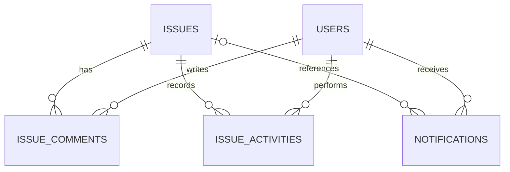

# Phase F: Collaboration and Auditability

## Data model

- `issue_comments` stores immutable, plain-text comments with the issue, author, body, and creation time. Issue deletion cascades comments; author deletion is restricted to retain attribution.
- `issue_activities` is append-only and records actor, action, optional field name, and safe before/after text values. Issue deletion cascades its activities; actor deletion is restricted.
- `notifications` belongs to a recipient, may refer to an issue, and stores a short message, event type, creation time, and nullable `read_at`. Issue deletion clears its reference and recipient deletion removes their notifications.
- All identifiers are UUIDs. Indexes support newest-first issue comments/activity and newest-first recipient notifications, including unread filtering.

## Behavior and API contract

All issue collaboration endpoints require an authenticated workspace member of the issue's project. A nonmember receives `404`. Comments and activities are readable on archived issues; comments cannot be added to archived issues or archived projects. Comments are append-only. Issue activities are read-only. Notification queries include only the recipient's own notifications and suppress issue-linked entries after workspace membership is removed; marking another user's or an inaccessible issue's notification read returns `404`.

| Method and path | Access | Behavior |
| --- | --- | --- |
| `GET /api/v1/issues/{issueId}/comments` | Workspace member | Newest-first, paginated comment page |
| `POST /api/v1/issues/{issueId}/comments` | Workspace member | Add a non-blank comment (maximum 5,000 characters); `201` |
| `GET /api/v1/issues/{issueId}/activities` | Workspace member | Newest-first, paginated activity page |
| `GET /api/v1/users/me/notifications` | Authenticated user | Page of only the current user's notifications; unread-only filter supported |
| `PATCH /api/v1/notifications/{notificationId}/read` | Notification recipient | Mark own notification read; other users receive `404` |

Issue create/update/archive/restore and comments append activities in the same transaction as the action. Assignment changes notify the new assignee. A new comment notifies the current assignee and reporter, excluding the author. Notifications are visible from the signed-in home screen and can be marked read. Notification delivery is in-app only; email and push are out of scope.

Comment and activity lists default to 20 records per page and cap page size at 100. They are ordered newest first. The notification list follows the same pagination limits and accepts `unreadOnly=true`.

Status transitions on update are restricted to `TODO -> IN_PROGRESS`, `IN_PROGRESS -> TODO | IN_REVIEW`, `IN_REVIEW -> IN_PROGRESS | DONE`, and `DONE -> IN_PROGRESS`. Keeping the current status is always valid. Creating an issue may select its initial status.

## Trade-offs

Comments are not editable or deletable in this milestone so the activity feed remains trustworthy without needing edit-history semantics. Activity before/after values are bounded text snapshots rather than JSON to keep the initial audit model small. Notifications are created only for assignment and comment events; status and general field changes remain visible in activity history without producing notification noise.
